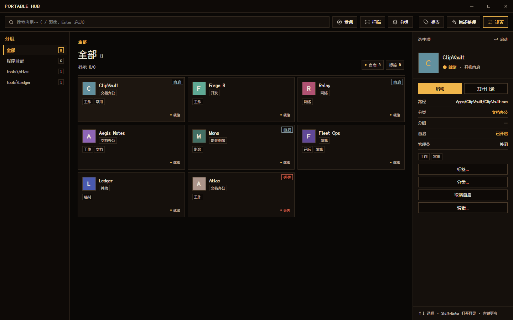

# PortableHub

Windows 10/11 便携软件管理器。Tauri 2 + Svelte 5，单 exe，默认像素风，支持自制主题。



> 平台边界：构建脚本与运行实现为 Windows 专用；配置格式、主题与文案表跨平台。
> 如需 macOS 构建，新增 `scripts/_mac/` 并在项目管理侧声明，不改共享脚本。

## 它能做什么

- 扫描 `Apps\` 下的绿色软件，以卡片网格展示；「添加应用」里也可从全盘发现并导入
- **Command Deck 主界面**：左库导航 + 应用矩阵 + 右侧选中详情；批量标签/分组/分类
- 「添加应用」统一入口：扫描应用目录 / 全盘发现共用一套结果审阅；同名重复位置自动合并
- 三套内置主题：像素暗夜（默认）、暖纸陈列、冷灰索引
- 单击选中、双击/Enter 启动，方向键选择，`Ctrl+Alt+P` 呼出，托盘常驻
- 搜索支持名称子串与**拼音首字母**（输入 `wx` 可找到「微信」）
- 右键菜单可编辑应用（名称 / 主程序路径 / 启动参数 / 工作目录）
- 导入结果显示成功/跳过/失败明细，可一键复制
- 逐条勾选开机自启（只写用户 Startup 快捷方式，**不写注册表**）；每次启动 Hub 会检测并补齐未运行的自启项
- 主题文件放在 `Themes\`，换肤即时生效；设置页左侧分区导航
- 配置、缓存、WebView2 数据全部在程序目录内，删目录即卸载

## 目录

```
PortableHub.exe
config.json
Apps\<应用>\...
Themes\<主题>.json
_cache\            # 图标、WebView2 数据、可删
```

## 下载

从 [Releases](https://github.com/yrui-ql/portablehub/releases) 下载 `PortableHub.exe`，
放到任意目录运行即可；首次运行会在同目录生成 `Apps\`、`Themes\` 和配置。

## 可移植性 / 路径规则

- **程序目录 = `PortableHub.exe` 所在目录**，运行时计算，不写死任何开发机路径；移动整个文件夹，配置、缓存、WebView2 数据都跟着走。
- **应用目录默认 `Apps`，相对程序目录存储**；设置里可改成其他已存在文件夹。程序目录内的目录会存相对路径，程序目录外的目录才存绝对路径（这是用户选择，不是默认写死）。
- 自动创建的 `Apps\`、`Themes\`、`_cache\` 都在程序目录内，不写 `AppData`、不写注册表；唯一例外是用户主动开启的「开机自启」会写当前用户的 Startup 快捷方式。
- 本地 `config.json`、`Apps\`、`Themes\` 不会进仓库；公开 Release 只带 exe，不携带任何人的配置或路径。
- 设置 → 目录中「程序目录」右侧的 `i` 会说明这一点；显示的是当前 exe 的真实位置，不是代码里的常量。

## 构建

前置：Node 22+、Rust（msvc）、MSVC Build Tools、WebView2 Runtime。

```powershell
powershell -ExecutionPolicy Bypass -File scripts/setup-toolchain.ps1 -Check
powershell -ExecutionPolicy Bypass -File scripts/setup-toolchain.ps1
npm install
powershell -ExecutionPolicy Bypass -File scripts/build.ps1
```

产物：`src-tauri/target/release/PortableHub.exe`。

## 验证

```powershell
powershell -ExecutionPolicy Bypass -File scripts/verify.ps1
```

依次跑私密词扫描（含 `src`、`tests`、`e2e`、`scripts`、`docs`）、前端单测、类型检查、
拼音表离线结构校验、浏览器 E2E、Rust 单测、release 构建与无界面自检；任一失败退出码非 0。

单独跑某个前端 E2E 套件：

```powershell
npm run e2e -- e2e/edit.spec.ts
```

`src/lib/pinyin-table.ts` 是生成产物，由 `node scripts/gen-pinyin-initials.mjs` 重放。两种校验语义不同：

- `node scripts/gen-pinyin-initials.mjs --check`：**联网校验**。重新下载 pinyin-data 并与已提交的表逐字比对；
  取源失败（断网、上游不可达）或映射漂移都算失败，退出码非 0。
- `node scripts/gen-pinyin-initials.mjs --check --offline`：**离线结构校验**。不联网，只检查已提交产物的
  结构、参考首字母与体积，输出会注明未与上游比对；`scripts/verify.ps1` 里跑的是这一档。

需要本地副本时用 `--source <pinyin.txt>` 指定源文件（文件不存在即失败）。

## 主题格式

```json
{
  "schemaVersion": 1,
  "id": "my-theme",
  "name": "我的主题",
  "author": "me",
  "vars": { "--ph-bg": "#101018", "--ph-accent": "#ff8800" },
  "css": ".ph-card { border-style: dashed; }"
}
```

可用变量与稳定选择器见 `docs/THEME.md`（待补）。CSS 禁止 `@import` 与外链。

## 许可

[MIT](LICENSE)。内置字体 FusionPixel 使用 SIL Open Font License，见
`src/assets/fonts/OFL.txt`；其他依赖的许可见 `package-lock.json` / `Cargo.lock`。